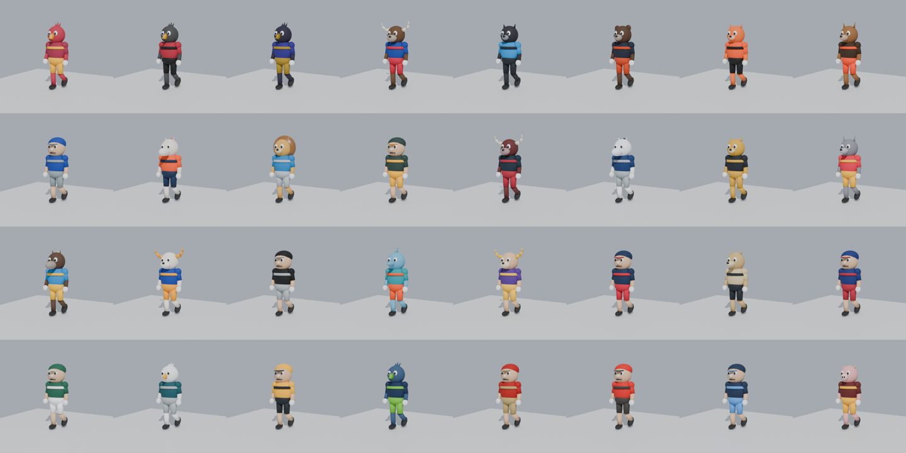

# Custom Mascots for Madden

Replace every NFL team's sideline mascot in Madden (PC) with a custom 3D mascot.



Madden has had scanned 3D mascots on the sidelines since Madden 26. This project
generates a replacement for each of the 32 teams: one skinned mesh in team
colours, a 17-bone humanoid rig, and a looping walk cycle. It exports each one
as an FBX that a Frostbite mod editor can import.

## What's here

| Path | What it does |
| --- | --- |
| `config/teams.json` | One entry per team: mascot name, head style, colours. Edit this to redesign a mascot. |
| `tools/build_mascot.py` | Builds the mesh, rig and walk animation and exports `build/<TEAM>/<TEAM>_mascot.fbx` and `.blend`. |
| `tools/validate_mascot.py` | Re-imports each FBX and checks triangle budget, skinning, scale, ground contact and that the walk loops cleanly. |
| `tools/render_preview.py` | Renders walk-cycle preview strips on the CPU (no GPU needed) and the gallery above. |
| `docs/IMPORTING.md` | How to get the FBX files into the game. |

Head styles: `bear`, `cat`, `lion`, `canine`, `equine`, `bird`, `horned`, `aquatic`, `hog`, `human`.
The mascot names in `teams.json` are original placeholders, not the real NFL mascots. Rename them freely.

## Build

You need Python 3.13 (the `bpy` wheels are built for that version only). You don't need a Blender install.

```bash
python3.13 -m venv .venv
```

```bash
.venv/bin/pip install -r requirements.txt
```

```bash
.venv/bin/python tools/build_mascot.py --team ALL
```

```bash
.venv/bin/python tools/validate_mascot.py
```

```bash
.venv/bin/python tools/render_preview.py ALL
```

To work on one team, pass its abbreviation instead of `ALL`, for example `--team CHI`.
Open `build/CHI/CHI_mascot.blend` in Blender 5.2+ and press play to watch
the mascot walk laps around a 3 m loop.

## Getting it into Madden

See [docs/IMPORTING.md](docs/IMPORTING.md). Short version: this repo produces the
models; swapping them into the game is done on a Windows PC with a Frostbite mod
editor and your own copy of Madden.

**Offline only.** Use mods in offline modes (Franchise, Play Now) only. EA's
anti-cheat can flag modified files, and modding in online modes breaks EA's
terms and can get your account banned.
